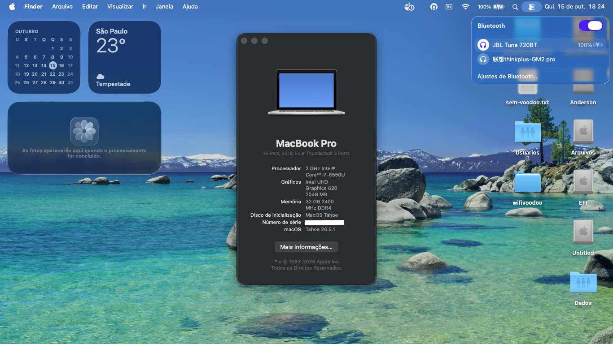

# Dell Latitude 3490 — OpenCore EFI (macOS Tahoe)

Working OpenCore EFI for the **Dell Latitude 3490** running **macOS Tahoe**. Nearly everything works. Shared to save others the trial-and-error.

> ⚠️ **READ THIS FIRST — you MUST generate your own SMBIOS before booting.** The `SystemSerialNumber`, `MLB`, `SystemUUID` and `ROM` in this EFI are **real serials from another machine**. Booting with these will break iMessage/FaceTime and can burn a serial. See [Setup](#setup) below.

## Hardware

| Component | Details |
|---|---|
| Model | Dell Latitude 3490 |
| CPU | Intel Core i7-8550U (Kaby Lake Refresh) |
| iGPU | Intel UHD Graphics 620 (`AAPL,ig-platform-id` = `0x5916001C`) |
| dGPU | None |
| Audio | Realtek ALC256/ALC3246 (AppleALC, `layout-id` 3, `alc-delay` 1200) |
| Wi-Fi/BT | Broadcom BCM4352 802.11ac Dual Band — using **IO80211FamilyLegacy** + **AirportBrcmFixup** (native macOS driver) |
| RAM | 32 GB |
| Ethernet | Realtek RTL8111 Gigabit (RealtekRTL8111.kext + IntelMausi disabled) |
| Touchpad | Synaptics I2C (VoodooPS2Trackpad) — ❌ Not working |
| SMBIOS | MacBookPro15,2 |

## What works / what doesn't

| Component | Status | Notes |
|---|---|---|
| Internal display | ✅ | Full QE/CI, Metal |
| Intel UHD 620 acceleration | ✅ | |
| Audio (speakers, mic, jack) | ✅ | AppleALC — combo jack for P3 output |
| HDMI / DisplayPort (via USB-C) | ✅ | USB-C to HDMI + USB-C to DisplayPort adapters |
| **Wi-Fi** | ✅ | IO80211FamilyLegacy + AirportBrcmFixup |
| **Bluetooth** | ✅ | BrcmPatchRAM3 + BlueToolFixup |
| Battery / sleep / lid | ✅ | SMCBatteryManager |
| Keyboard + backlight | ✅ | VoodooPS2 |
| Touchpad gestures | ❌ | VoodooPS2Trackpad (not working) |
| CPU temp / fan sensors | ✅ | SMCDellSensors + SMCProcessor + SMCSuperIO |
| Ethernet | ✅ | RealtekRTL8111 |
| NVMe SSD | ✅ | SATA-unsupported.kext + NVMeFix |

## Setup

1.  **Generate your own SMBIOS** with [GenSMBIOS](https://github.com/corpnewt/GenSMBIOS) for `MacBookPro15,2`, then fill in `PlatformInfo > Generic`:
    -   `SystemSerialNumber`, `MLB`, `SystemUUID`
    -   `ROM` → use your machine's real Ethernet MAC (en0), or the last 6 bytes of your Wi-Fi MAC.
2.  **BIOS settings** (F2 at boot):
    -   Disable **Secure Boot**
    -   Set **SATA Operation → AHCI**
    -   Disable **CFG Lock** (or keep `AppleXcpmCfgLock`/`AppleCpuPmCfgLock` quirks enabled, which this EFI does)
    -   Set **DVMT Pre-Allocated → 64MB** or higher if possible; if you can set it in BIOS, remove `framebuffer-stolenmem`/`framebuffer-fbmem` from the iGPU device props
    -   Enable **Virtualization (VT-x)** if you want VMs (Hypervisor.framework needs it)
3.  Copy `EFI/` to your USB/ESP, boot, install/boot Tahoe.

## Notable fixes (the valuable bits)

### Wi-Fi (Broadcom BCM4352) — Legacy approach

This EFI uses the **IO80211FamilyLegacy** approach instead of AirportItlwm. This is the correct method for **native Broadcom** cards (BCM4352, BCM4360, etc.) on newer macOS versions.

Key kexts: `IO80211FamilyLegacy.kext` + `AirportBrcmFixup.kext` + `AirPortBrcmNIC.kext` (embedded).

The `Kernel > Block` entry excludes `IOSkywalkFamily` for kernel versions `23.0.0` to `25.99.99`, which is required to allow the legacy 802.11 family to load on Tahoe.

Boot args include `-no_compat_check` to bypass kext compatibility checks.

### Bluetooth (BCM4352) — Tahoe compatibility

Two things are needed:

1.  Kexts: `BrcmFirmwareData.kext`, `BrcmPatchRAM3.kext`, `BlueToolFixup.kext` in `Kernel > Add`.
2.  **Boot args**: `-brcmfx-driver=2 -brcmfxbeta` (beta flags required for Tahoe compatibility).
3.  **NVRAM**: `bluetoothInternalControllerInfo` (17 bytes) and `bluetoothExternalDongleFailed` (1 byte) in `NVRAM > Add` GUID `7C436110-AB2A-4BBB-A880-FE41995C9F82`.

### AMFIPass — code signature bypass

This EFI includes **AMFIPass.kext v1.4.1** with boot arg `-amfipassbeta`. This is required for Tahoe to allow unsigned/modified kexts to load without disabling SIP entirely. CSR active config is set to `0x000A` (allows `CSR_ALLOW_UNTRUSTED_KEXTS` + `CSR_ALLOW_UNAPPROVED_KEXTS`).

### OpenCore Legacy Patcher

This build uses **OpenCore Legacy Patcher** to apply additional patches required for newer macOS versions on older hardware. OCLP provides pre-built kexts and patches for features like Wi-Fi, Bluetooth, and graphics on unsupported Mac models.

### CPU Power Management (U-series)

`DummyPowerManagement` is enabled in `Kernel > Emulate` because the i7-8550U is a mobile U-series CPU that doesn't natively support Apple's power management. Combined with `SMCProcessor.kext` and `SMCDellSensors.kext`, this provides proper fan control, thermal sensors, and CPU frequency scaling.

### NVMe / SSD

Primary drive: **KINGSTON SNV2S1000G** (1TB, NVMe Gen4 x4 8.0 GT/s). `SATA-unsupported.kext` forces macOS to load NVMe drives that it would otherwise ignore. `NVMeFix.kext` prevents kernel panics on sleep/wake with generic NVMe drives.

## Kexts

| Kext | Version | Purpose |
|---|---|---|
| Lilu | 1.7.2 | Base patcher |
| VirtualSMC | 1.3.7 | SMC emulation |
| SMCBatteryManager | 1.3.7 | Battery sensing |
| SMCDellSensors | 1.3.7 | Dell-specific sensors/fan control |
| SMCProcessor | 1.3.7 | CPU sensors |
| SMCLightSensor | 1.3.7 | Ambient light sensor |
| SMCSuperIO | 1.3.7 | Fan RPM / hardware monitoring |
| WhateverGreen | 1.7.0 | iGPU patching |
| AppleALC | 1.9.7 | Audio patching |
| AirportBrcmFixup | 2.2.0 | Broadcom Wi-Fi fixes |
| IO80211FamilyLegacy | 1200.12.2b1 | Native Broadcom Wi-Fi |
| IOSkywalkFamily | 1.0 | Network stack (blocked for downgrade) |
| RestrictEvents | 1.1.6 | Hardware restriction fixes |
| BlueToolFixup | 2.7.2 | Bluetooth fix for Monterey+ |
| BrcmFirmwareData | 2.7.2 | Broadcom BT firmware |
| BrcmPatchRAM3 | 2.7.2 | Broadcom BT patcher |
| IntelMausi | 1.0.9 | Intel Ethernet (present but not used — RTL8111 active) |
| RealtekRTL8111 | 3.0.4 | Realtek Gigabit Ethernet |
| NVMeFix | 1.1.3 | NVMe sleep fix |
| SATA-unsupported | 0.9.2 | Force NVMe detection |
| AMFIPass | 1.4.1 | Code signature bypass |
| VoodooPS2Controller | 2.3.8 | Keyboard + Trackpad |
| USBMap | 1.0 | USB port map |
| VerbStub | 1.0.4 | Audio verb stub |

> **Kext versions matter.** VirtualSMC plugins must match VirtualSMC's version. When updating macOS, update Lilu + all Lilu-based kexts together.

## ACPI (SSDTs)

| SSDT | Purpose |
|---|---|
| SSDT-EC.aml | Embedded Controller stub |
| SSDT-HPET.aml | HPET fix + `_STA`/`_CRS` to `XSTA`/`XCRS` rename |
| SSDT-PLUG-DRTNIA.aml | XPU plugin for power management |
| SSDT-PNLF.aml | Backlight control |
| SSDT-USBX.aml | USB power injection |
| SSDT-XOSI.aml | OS identification patches (Windows -> macOS) |

### ACPI Patches

-   HPET `_STA` → `XSTA` rename
-   HPET `_CRS` → `XCRS` rename
-   IPIC IRQ 2 patch
-   RTC IRQ 8 patch
-   TIMR IRQ 0 patch
-   PNLF → XNLF rename
-   OSID → XSID rename
-   `_OSI` → `XOSI` rename

## NVRAM

Boot args: `brcmfx-driver=2 -no_compat_check igfxonln=1 -amfipassbeta -brcmfxbeta`

CSR active config: `0x000A` (allows untrusted + unapproved kexts)

Custom NVRAM entries:
-   `revcpu` = 1, `revcpuname` = "Intel® Core™ i7-8550U", `revpatch` = "cpuname,diskread" (CPU name spoofing in About This Mac)

## Credits

Based on the work of [Acidanthera](https://github.com/acidanthera), [OpenIntelWireless](https://github.com/OpenIntelWireless), [VoodooI2C](https://github.com/VoodooI2C/VoodooI2C), and the Hackintosh community.

---

*Provided as-is. Always generate your own SMBIOS. Not affiliated with Apple or Dell.*
